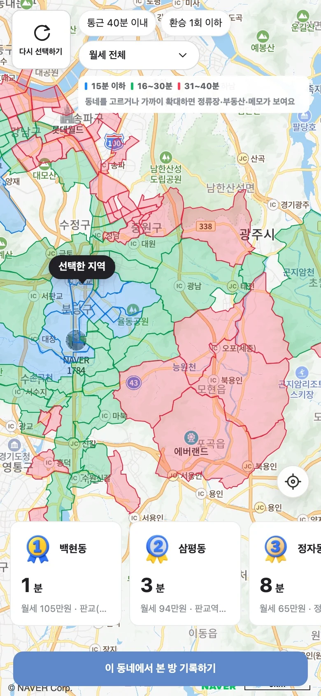
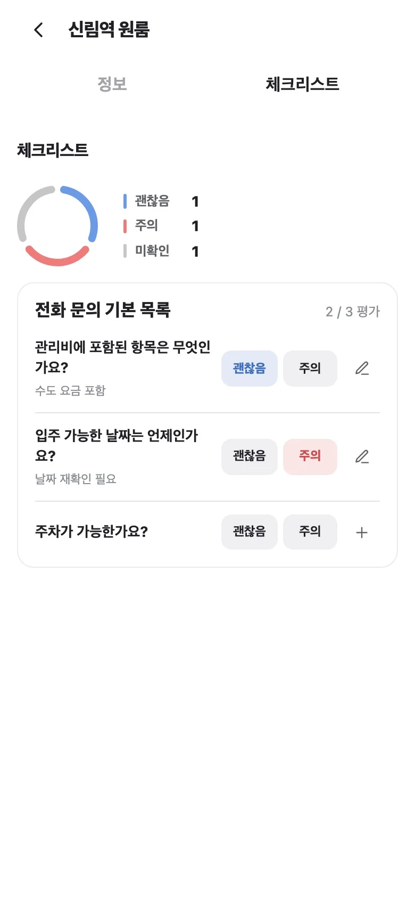
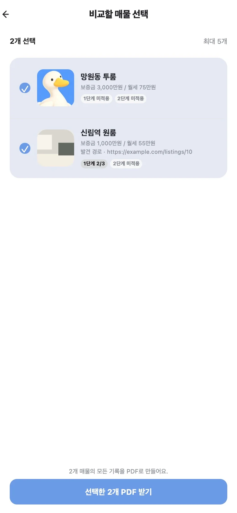
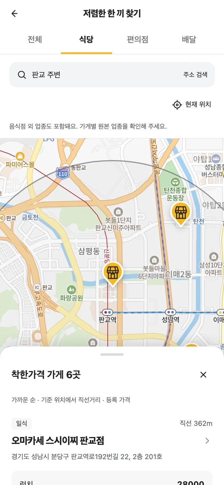

<div align="center">


# 자취선배

### 집은 매물 앱에서 찾고, 결정은 자취선배에서.

자취할 동네를 찾고, 직접 본 방은 기록하고 비교해요.

[](https://www.jachwi-sunbae.kr) [](https://apps.apple.com/kr/app/id6816321229) [](https://play.google.com/store/apps/details?id=com.jachwisunbae)

[서비스 소개](#자취선배가-필요한-순간) | [핵심 기능](#핵심-기능) | [사용 방법](#이렇게-사용해요) | [아키텍처](#아키텍처) | [기술 스택](#기술-스택) | [개발 문서](#개발-문서)

</div>

<br />

## 자취선배가 필요한 순간

매물 링크와 사진은 쌓였는데, 어느 방이 좋았는지 기억나지 않나요?
여러 플랫폼에서 찾은 후보와 직접 확인한 내용을 한곳에 남기고, 나에게 맞는 방을 결정할 수 있도록 돕습니다.

| 집을 구할 때 생기는 고민                    | 자취선배에서 할 수 있는 일                           |
| ------------------------------------------- | ---------------------------------------------------- |
| 회사나 학교까지 다닐 만한 동네를 모르겠어요 | 통근 조건으로 동네를 찾고 주변 환경을 확인해요       |
| 여러 앱에서 찾은 매물 정보가 흩어져 있어요  | 후보를 지도와 목록에 모으고 사진과 메모를 남겨요     |
| 방을 볼 때 무엇부터 확인할지 막막해요       | 체크리스트로 상태를 평가하고 질문 바로 아래 기록해요 |
| 여러 방을 보고 나니 장단점이 헷갈려요       | 기록을 나란히 비교하고 PDF로 보관해요                |

**계정 입력 없이 바로 시작할 수 있어요.** 익명 회원으로 기록을 시작하고, 기록을 보관하거나 다른 기기에서 이어 쓰려면 카카오 또는 Apple 계정을 연결할 수 있습니다.

<br />

## 핵심 기능

| 기능                          | 무엇을 할 수 있나요?                                                             |
| ----------------------------- | -------------------------------------------------------------------------------- |
| **통근 조건으로 동네 찾기**   | 회사나 학교를 기준으로 통근 시간, 환승 횟수와 월세 조건에 맞는 동네를 찾아요.    |
| **본 방 기록**                | 지도에 매물을 등록하고 보증금, 월세, 사진과 메모를 한곳에 모아요.                |
| **나만의 거리 메모**          | 지도에서 선택한 위치에 좋아요, 싫어요와 메모를 남겨요. 기록은 본인에게만 보여요. |
| **현장과 계약 전 체크리스트** | 채광과 소음부터 계약 확인 사항까지 평가하고, 나에게 필요한 질문을 편집해요.      |
| **방 비교와 PDF**             | 후보의 가격과 체크 진행을 비교하고, 고른 방의 기록을 PDF로 받아요.               |
| **저렴한 한 끼 찾기**         | 주변 착한가격업소와 메뉴 가격, 편의점 행사상품과 배달 할인을 확인해요.           |

<br />

## 이렇게 사용해요

<table>
  <tr>
    <td align="center" width="240"></td>
    <td valign="top">
      <h3>회사나 학교까지, 다닐 수 있는 동네부터 찾아요</h3>
      <p>회사나 학교를 목적지로 정하고 원하는 통근 시간과 환승 조건을 선택해 보세요.</p>
      <p>지도에 걸리는 시간별로 표시된 동네를 보고, 월세 조건까지 더해 후보를 좁힐 수 있어요.</p>
      <p>마음에 드는 동네의 경로와 주변 중개사도 확인해 보세요.</p>
    </td>
  </tr>
  <tr>
    <td align="center" width="240"></td>
    <td valign="top">
      <h3>집을 보고 나왔다면, 기억이 흐려지기 전에 기록해요</h3>
      <p>본 방의 위치를 지도에 찍고 이름, 보증금과 월세를 남겨 보세요.</p>
      <p>사진과 자유 메모를 더하면 여러 매물 앱에서 찾은 후보도 한곳에 모아 볼 수 있어요.</p>
      <p>지도와 목록을 오가며 기록한 방을 다시 찾아보세요.</p>
    </td>
  </tr>
  <tr>
    <td align="center" width="240"></td>
    <td valign="top">
      <h3>방을 볼 때는 체크리스트로 하나씩 확인해요</h3>
      <p>현장에서 채광, 소음, 보안과 시설 상태를 괜찮음 또는 주의로 평가해 보세요. 확인하지 않은 항목은 미확인으로 남아요.</p>
      <p>항목 바로 아래 메모를 남겨 숫자만으로 기억하기 어려운 느낌도 기록할 수 있어요.</p>
      <p>나에게 필요한 질문을 편집하고, 계약 전 확인 사항까지 이어서 살펴보세요.</p>
    </td>
  </tr>
  <tr>
    <td align="center" width="240"></td>
    <td valign="top">
      <h3>고민되는 방은 함께 살펴보고 PDF로 남겨요</h3>
      <p>이름과 월세, 체크 여부로 후보를 찾고 비교할 방을 골라 보세요.</p>
      <p>가격과 체크 진행을 살펴보고, 선택한 방의 사진과 메모를 포함한 기록을 PDF로 받아 보세요.</p>
      <p>파일로 보관하거나 함께 집을 고르는 사람과 확인할 수 있어요.</p>
    </td>
  </tr>
  <tr>
    <td align="center" width="240"></td>
    <td valign="top">
      <h3>살고 싶은 동네의 한 끼 가격도 미리 알아봐요</h3>
      <p>위치를 정하면 주변 착한가격업소와 메뉴 가격을 지도와 목록에서 볼 수 있어요.</p>
      <p>편의점 행사상품과 배달 할인도 함께 확인하고, 동네를 고를 때 생활비까지 생각해 보세요.</p>
    </td>
  </tr>
</table>

<br />

## 아키텍처

### Frontend


### Backend

<!-- BACKEND_ARCHITECTURE_START: 수정된 백엔드 구성도를 이 자리에 추가합니다. -->

> 백엔드 아키텍처는 수정본이 준비되면 이 자리에 추가합니다.

<!-- BACKEND_ARCHITECTURE_END -->

<br />

## 기술 스택

### Frontend

    

### App

   

### Backend

   

### 개발과 테스트

     

| 역할             | 도구                    | 사용 목적                                         |
| ---------------- | ----------------------- | ------------------------------------------------- |
| 화면 스타일      | Emotion                 | 컴포넌트 스타일 작성                              |
| UI 개발과 문서화 | Storybook               | 컴포넌트 상태별 화면과 접근성 확인                |
| API 모킹         | MSW                     | 개발 화면과 테스트에서 API 응답 재현              |
| 웹 테스트        | Vitest, Testing Library | 컴포넌트와 사용자 상호작용 검증                   |
| E2E QA           | Playwright              | 브라우저에서 사용자 흐름 검증                     |
| 앱 테스트        | Jest                    | React Native 앱 코드 검증                         |
| 테스트 검증력    | Stryker                 | 코드 변이를 통한 테스트 검증, 라벨 또는 수동 실행 |
| 코드 품질        | ESLint, Prettier        | 코드 규칙과 포맷 검사                             |

### Infrastructure and Observability

   

<br />

## 개발 문서

<details>
<summary>개발과 운영 안내 보기</summary>

| 구분   | 문서                                                                                                                        |
| ------ | --------------------------------------------------------------------------------------------------------------------------- |
| 제품   | [기능별 요구사항과 정책](docs/product/README.md)                                                                            |
| 개발   | [프론트엔드](frontend/README.md), [백엔드](backend/docs/README.md), [모바일 앱](mobile/README.md)                           |
| 협업   | [컨벤션](docs/convention/README.md), [Markdown 작성 규칙](docs/convention/markdown-formatting.md)                           |
| 품질   | [QA 안내](qa/README.md), [프론트 테스트 전략](frontend/docs/testing-strategy.md)                                            |
| 배포   | [웹 배포](frontend/docs/deployment.md), [백엔드 배포](backend/docs/operations/deployment.md)                                |
| 설정   | [백엔드 환경변수](backend/docs/guides/environment-variables.md), [프론트 공개 빌드 설정](frontend/README.md#공개-빌드-설정) |
| 릴리스 | [변경 내역](CHANGELOG.md), [버전 관리](docs/convention/versioning.md)                                                       |

### 실행 환경

| 환경 | 브랜치    | 프론트엔드                   | 백엔드                           |
| ---- | --------- | ---------------------------- | -------------------------------- |
| dev  | `develop` | https://dev.jachwi-sunbae.kr | https://dev-api.jachwi-sunbae.kr |
| prod | `main`    | https://www.jachwi-sunbae.kr | https://api.jachwi-sunbae.kr     |

### 저장소 구조

```text
2026-jachwi-sunbae/
├── .github/     # CI와 협업 템플릿
├── backend/     # Spring Boot API와 백엔드 배포
├── frontend/    # React 웹과 정적 자산 배포
├── mobile/      # iOS와 Android WebView 앱셸
├── qa/          # E2E QA 기준과 Playwright 실행 코드
└── docs/        # 제품 명세, 컨벤션과 아키텍처
```

<details>
<summary>로컬에서 실행하기</summary>

외부 키 없이 demo 지도와 MinIO를 사용합니다. 프론트의 Node.js 버전은 [`.nvmrc`](frontend/.nvmrc)를 따릅니다.

```bash
cd backend
cp .env.example .env
set -a
source .env
set +a
docker compose up -d
./gradlew bootRun
```

다른 터미널에서 실행합니다.

```bash
cd frontend
nvm use
cp .env.example .env.local
npm ci
npm run dev
```

- 웹: `http://localhost:3000`
- Swagger UI: `http://localhost:8080/swagger-ui/index.html`
- MinIO 콘솔: `http://localhost:9001`

같은 브라우저나 앱에서는 HttpOnly Refresh 쿠키로 같은 회원의 기록을 이어 사용합니다.

</details>

</details>
