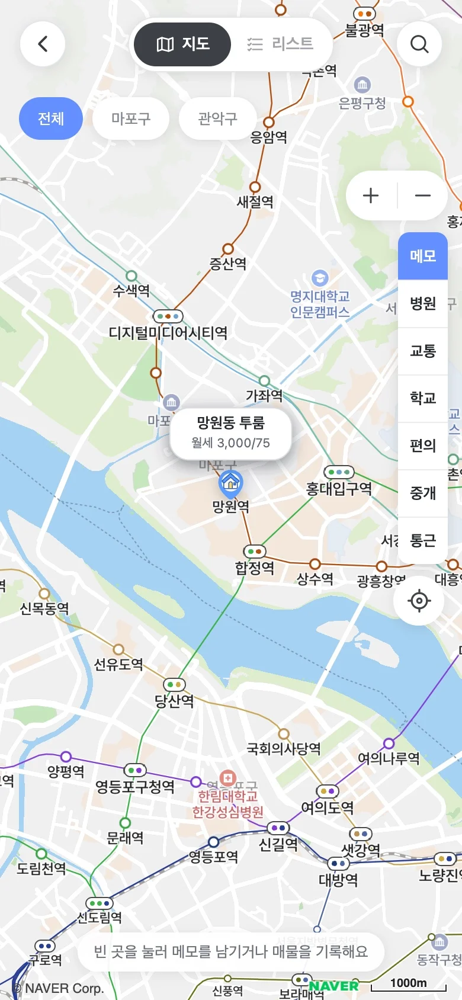
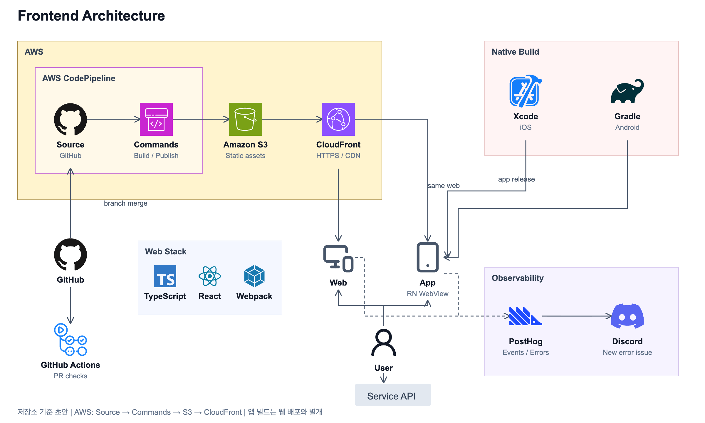

<div align="center">


# 자취선배

### 집은 매물 앱에서 찾고, 결정은 자취선배에서.

자취할 동네를 찾고, 직접 본 방은 기록하고 비교해요.

[](https://www.jachwi-sunbae.kr) [](https://apps.apple.com/kr/app/id6816321229) [](https://play.google.com/store/apps/details?id=com.jachwisunbae)

[서비스 소개](#자취선배가-필요한-순간) | [주요 화면](#이렇게-사용해요) | [아키텍처](#아키텍처) | [기술 스택](#기술-스택) | [개발 문서](#개발-문서)

</div>

<br />

## 자취선배가 필요한 순간

매물 링크와 사진은 쌓였는데, 어느 방이 좋았는지 기억나지 않나요?
여러 플랫폼에서 찾은 후보와 직접 확인한 내용을 한곳에 남기고, 나에게 맞는 방을 결정할 수 있도록 돕습니다.

| 집을 구할 때 생기는 고민                    | 자취선배에서 할 수 있는 일                           |
| ------------------------------------------- | ---------------------------------------------------- |
| 회사나 학교까지 다닐 만한 동네를 모르겠어요 | 통근 조건으로 동네를 찾고 주변 환경을 확인해요       |
| 여러 앱에서 찾은 매물 정보가 흩어져 있어요  | 후보를 지도와 목록에 모으고 사진과 메모를 남겨요     |
| 방을 볼 때 무엇부터 확인할지 막막해요       | 체크리스트로 상태를 평가하고 질문 바로 아래 기록해요 |
| 여러 방을 보고 나니 장단점이 헷갈려요       | 기록을 나란히 비교하고 PDF로 보관해요                |

**계정 입력 없이 바로 시작할 수 있어요.** 익명 회원으로 기록을 시작하고, 기록을 보관하거나 다른 기기에서 이어 쓰려면 카카오 또는 Apple 계정을 연결할 수 있습니다.

<br />

## 이렇게 사용해요

<table>
  <tr>
    <th align="center">동네 찾기</th>
    <th align="center">본 방 기록</th>
    <th align="center">현장 체크리스트</th>
    <th align="center">방 비교</th>
  </tr>
  <tr>
    <td align="center"></td>
    <td align="center"></td>
    <td align="center"></td>
    <td align="center"></td>
  </tr>
  <tr>
    <td>통근 시간과 환승 조건으로 살고 싶은 동네를 좁혀요.</td>
    <td>직접 본 방의 위치, 가격, 사진과 메모를 한곳에 남겨요.</td>
    <td>괜찮음, 주의, 미확인으로 평가하고 현장의 느낌을 기록해요.</td>
    <td>방마다 다른 조건과 확인 내용을 비교하고 PDF로 받아요.</td>
  </tr>
</table>

화면 이미지는 저장소의 서비스 소개용 예시입니다. 자세한 기능과 정책은 [제품 문서](docs/product/README.md)에서 확인할 수 있습니다.

<br />

## 아키텍처

### Frontend



- **웹 배포**: CodePipeline Source가 GitHub 변경을 가져오고 Commands가 빌드, S3 업로드, CloudFront 캐시 무효화와 배포 검증을 실행합니다. `develop`은 dev, `main`은 prod로 배포합니다.
- **앱**: React Native WebView에서 같은 웹을 제공합니다. 네이티브 변경은 Xcode와 Gradle로 별도 빌드하고 배포합니다.
- **관측**: 웹의 행동과 오류를 PostHog로 수집하고 새 오류 이슈를 Discord로 알립니다. 환경은 이벤트 속성으로 구분합니다.

구성도는 저장소 코드와 배포 문서 기준입니다. [확대용 SVG](docs/images/architecture/frontend.svg), [편집용 draw.io 원본](docs/images/architecture/frontend.drawio), [출처와 표현 범위](docs/images/architecture/README.md)를 함께 제공합니다.

### Backend

<!-- BACKEND_ARCHITECTURE_START: 수정된 백엔드 구성도를 이 자리에 추가합니다. -->

> 백엔드 아키텍처는 수정본이 준비되면 이 자리에 추가합니다.

<!-- BACKEND_ARCHITECTURE_END -->

<br />

## 기술 스택

### Frontend

     

### App

   

### Backend

   

### Infrastructure and Observability

   

<br />

## 개발 문서

| 구분   | 문서                                                                                                                        |
| ------ | --------------------------------------------------------------------------------------------------------------------------- |
| 제품   | [기능별 요구사항과 정책](docs/product/README.md)                                                                            |
| 개발   | [프론트엔드](frontend/README.md), [백엔드](backend/docs/README.md), [모바일 앱](mobile/README.md)                           |
| 협업   | [컨벤션](docs/convention/README.md), [Markdown 작성 규칙](docs/convention/markdown-formatting.md)                           |
| 품질   | [QA 안내](qa/README.md), [프론트 테스트 전략](frontend/docs/testing-strategy.md)                                            |
| 배포   | [웹 배포](frontend/docs/deployment.md), [백엔드 배포](backend/docs/operations/deployment.md)                                |
| 설정   | [백엔드 환경변수](backend/docs/guides/environment-variables.md), [프론트 공개 빌드 설정](frontend/README.md#공개-빌드-설정) |
| 릴리스 | [변경 내역](CHANGELOG.md), [버전 관리](docs/convention/versioning.md)                                                       |

### 실행 환경

| 환경 | 브랜치    | 프론트엔드                   | 백엔드                           |
| ---- | --------- | ---------------------------- | -------------------------------- |
| dev  | `develop` | https://dev.jachwi-sunbae.kr | https://dev-api.jachwi-sunbae.kr |
| prod | `main`    | https://www.jachwi-sunbae.kr | https://api.jachwi-sunbae.kr     |

### 저장소 구조

```text
2026-jachwi-sunbae/
├── .github/     # CI와 협업 템플릿
├── backend/     # Spring Boot API와 백엔드 배포
├── frontend/    # React 웹과 정적 자산 배포
├── mobile/      # iOS와 Android WebView 앱셸
├── qa/          # E2E QA 기준과 Playwright 실행 코드
└── docs/        # 제품 명세, 컨벤션과 아키텍처
```

<details>
<summary>로컬에서 실행하기</summary>

외부 키 없이 demo 지도와 MinIO를 사용합니다. 프론트의 Node.js 버전은 [`.nvmrc`](frontend/.nvmrc)를 따릅니다.

```bash
cd backend
cp .env.example .env
set -a
source .env
set +a
docker compose up -d
./gradlew bootRun
```

다른 터미널에서 실행합니다.

```bash
cd frontend
nvm use
cp .env.example .env.local
npm ci
npm run dev
```

- 웹: `http://localhost:3000`
- Swagger UI: `http://localhost:8080/swagger-ui/index.html`
- MinIO 콘솔: `http://localhost:9001`

같은 브라우저나 앱에서는 HttpOnly Refresh 쿠키로 같은 회원의 기록을 이어 사용합니다.

</details>
