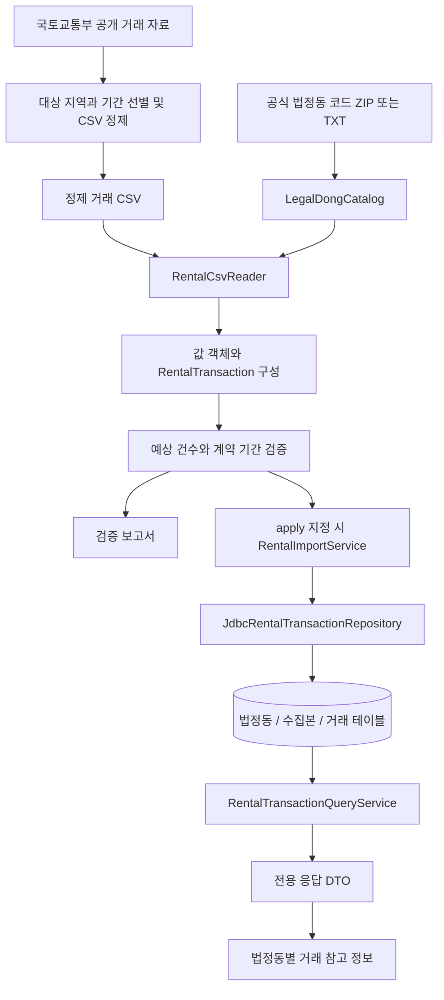
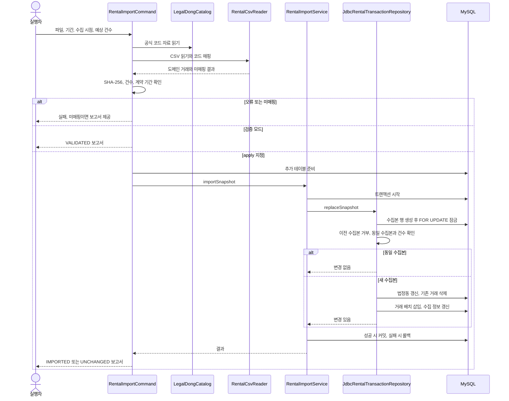
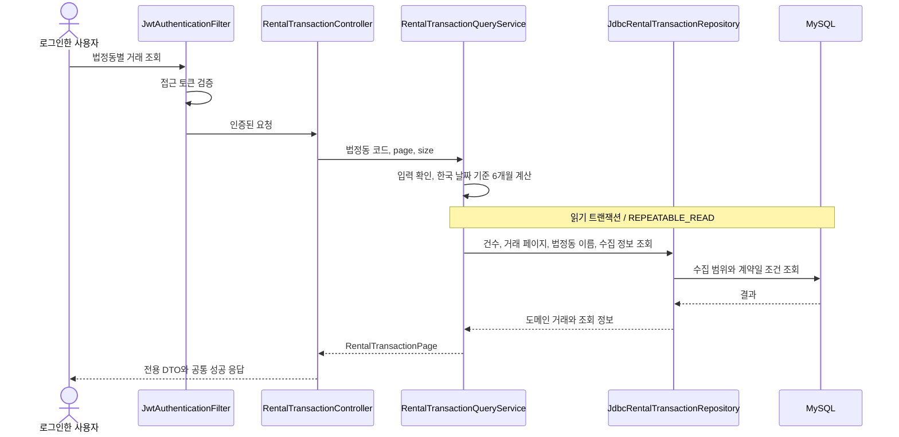

# 소형 주택 월세 거래 설계와 리뷰 안내

추천 지역의 주거비를 판단할 수 있도록 공공 거래 사례를 적재하고 법정동별로 조회한다. 제품 정책은 [기능 명세](../../../src/product/specs/rental-transactions.md), 실행 절차는 [적재 가이드](../guides/rental-data-import.md), HTTP 계약은 Swagger에서 관리한다. 이 문서는 구현 경계와 선택 이유를 설명한다.

## 구현 범위

- 정제된 국토교통부 CSV와 공식 법정동 코드 자료를 검증하고 MySQL에 적재한다.
- 로그인한 사용자가 법정동별 최근 6개월 거래를 페이지 단위로 조회한다.
- 추천 지역을 법정동 코드로 연결하는 화면, 외부 API 자동 수집, 정기 갱신과 가격 요약은 후속 작업이다.

## 데이터 흐름과 경계

원본 다운로드와 CSV 정제는 명령의 입력 준비 단계다. 적재 명령은 원본을 자동 다운로드하거나 지역을 자동 선별하지 않는다. 잘못된 데이터는 제외 후 부분 적재하지 않고 검증 단계에서 실패시킨다. 법정동 미매핑은 별도 보고서로 남기며 하나라도 있으면 적재하지 않는다.

| 경계                 | 변환과 검증                                                                              |
| -------------------- | ---------------------------------------------------------------------------------------- |
| 공식 코드 → 카탈로그 | MS949 인코딩, 현재 존재하는 코드, 시도부터 리까지 전체 이름 일치. 공백만 정규화한다.     |
| CSV → 도메인         | UTF-8 BOM·인용 필드 파싱, 만원에서 원으로 정확한 변환, 유형·면적 기준·계약 구분 변환.    |
| 도메인 → DB          | 값 객체를 SQL 컬럼으로 풀어 저장하고 파일·행 번호를 보존한다.                            |
| DB → 도메인          | 같은 값 객체로 복원하여 불변식을 다시 검증한다. 잘못 저장된 거래는 서버 오류로 처리한다. |
| 서비스 → 응답        | 전용 DTO로 변환한다. 내부 값 객체 구조와 원본 파일·행 번호를 노출하지 않는다.            |

## 적재 호출 관계

`RentalImportService`의 `TransactionTemplate`이 교체의 원자성을 보장한다. 수집 범위 키의 행 잠금으로 같은 범위의 동시 적재를 직렬화한다. 테이블 생성은 데이터 교체 트랜잭션 전에 실행되므로 실패 시 생성된 빈 테이블까지 롤백되지는 않는다. 데이터 교체 중 실패하면 기존 거래·법정동 변경·수집 메타데이터는 함께 롤백된다.

## 조회 호출 관계

토큰이 없거나 잘못되면 인증 필터에서 실패한다. 입력이 잘못되면 400이며, 정상 형식의 코드에 자료가 없으면 200과 빈 목록을 반환한다. 목록·건수·수집 정보는 한 읽기 트랜잭션에서 조회하여 자료 교체 중 서로 다른 수집본의 결과가 섞이지 않게 한다. 날짜는 주입한 `Clock`으로 계산하여 한국 날짜의 경계를 테스트할 수 있다.

## 설계 결정과 대안

| 결정                               | 이유와 검토한 대안                                                                                                                                                                                                             |
| ---------------------------------- | ------------------------------------------------------------------------------------------------------------------------------------------------------------------------------------------------------------------------------ |
| CSV를 검증하고 명시적으로 적재     | 활용 인증키가 필요한 API 자동 수집에 앞서 공식 공개 자료로 조회 기능을 제공한다. 요청마다 외부 API를 호출하는 방식은 응답 지연과 장애를 조회 흐름에 전파하므로 이번에는 사용하지 않는다.                                       |
| 사용자 매물과 별도 `rental` 도메인 | 공공 계약 사례는 사용자의 후보 매물·체크리스트와 생명주기가 다르다. `properties`에 함께 넣는 방식은 소유권과 현재 매물 여부의 의미를 혼합한다.                                                                                 |
| 네 가지 불변 값 객체               | `LegalDong`, `RentalPrice`, `RentalArea`, `RentalSource`가 관련 값과 검증을 묶는다. 평평한 거래 레코드에 모든 검증을 두는 대안보다 생성·DB 복원에서 같은 규칙을 적용하기 쉽다. 유형과 면적 기준의 조합 규칙은 거래가 담당한다. |
| 수집 범위의 전체 교체              | 실제 계약의 안정적인 식별자가 없어 추가 삽입만으로는 정정 반영과 중복 누적을 관리하기 어렵다. 검증된 전체 파일을 하나의 트랜잭션으로 교체하며, 같은 파일·코드·기간·시점은 재적재하지 않는다.                                   |
| 원본 파일과 행 번호를 보존         | 같은 가격·면적·날짜의 서로 다른 계약을 합치지 않는다. 파일·행 번호는 입력 추적과 동일 원본 행 중복 방지를 위한 식별자이며 실제 계약의 고유 ID는 아니다.                                                                        |
| 고정 조건과 페이지 조회            | 사용자의 추가 입력을 줄인다. 면적은 반올림 평수 대신 원본 ㎡에 정확한 경계를 적용하고, 목록은 계약일·ID 내림차순으로 정렬한다. 커서 페이지 방식은 갱신 중 연속 조회 요구를 구체화한 뒤 검토한다.                               |

## 사이드 이펙트와 운영 제약

- 기존 DB에는 추가 SQL을 적용해야 한다. 초기화 SQL 파일 추가만으로 실행 중인 DB가 자동 변경되지는 않는다. 적재 명령의 `--apply`가 해당 테이블을 준비한다.
- 전체 교체가 거래 ID를 재발급한다. 서로 다른 요청 사이에 갱신이 발생하면 페이지의 연속성이 깨질 수 있어 화면은 처음부터 다시 조회해야 한다. 한 응답의 일관성은 보장하지만 여러 요청을 같은 수집본에 고정하는 기능은 없다.
- 예상 건수는 입력 손실을 확인하지만, 모든 대상 시·군이 들어 있는지 자동 증명하지 않는다. 실행자는 수집 보고서와 대상 지역을 확인해야 한다.
- 계약면적과 전용면적을 구분해 제공한다. 값이 소형 면적 범위에 있어도 실제 원룸 여부·관리비·현재 입주 가능 여부는 확인할 수 없다.
- 조회 기간은 오늘 기준으로 이동한다. 수집본을 갱신하지 않으면 조회 기간 중 최신 자료가 부족해지고 결과 건수도 감소한다. 응답에 수집 기간·시점을 별도로 제공한다.
- 전체 CSV 파싱과 배치 삽입을 수행하므로 더 큰 수집 범위는 메모리 사용량과 적재 시간을 다시 측정해야 한다. DB 잠금은 적재를 직렬화하며 자동 수집·갱신 주기는 아직 구현하지 않았다.
- 법정동 이름은 매핑된 자료로 저장한다. 수집 이력이 없는 코드의 이름은 `null`이며, 외부 주소 서비스로 추측하지 않는다.

## 권장 검토 순서

1. 제품 명세로 제공 범위와 표현을 확인하고 이 문서의 흐름도를 읽는다.
2. `domain`과 `003-rental-schema.sql`에서 값 객체의 불변식, 금액 단위와 면적 기준을 확인한다.
3. `LegalDongCatalog` → `RentalCsvReader` → `RentalImportCommand` → `RentalImportService` → `replaceSnapshot` 순서로 매핑·중복·교체 트랜잭션을 확인한다.
4. `RentalTransactionController` → `RentalTransactionQueryService` → 조회 SQL → 응답 DTO 순서로 인증, 기간, 정렬, 페이지와 수집 정보의 의미를 확인한다.
5. 아래 테스트와 적재 가이드에서 실패 상황과 실행 조건을 확인한다.

| 테스트                                       | 확인하는 위험                                                                     |
| -------------------------------------------- | --------------------------------------------------------------------------------- |
| `RentalValueObjectsTest`                     | 값 객체 동등성, 면적 정밀도·경계, 금액·법정동·원본 행 규칙                        |
| `LegalDongCatalogTest`                       | 공식 ZIP 인코딩, 폐지 코드 제외, 동명이인과 모호한 매핑                           |
| `RentalCsvReaderTest`                        | 만원→원 변환, BOM·인용 필드, 주택 유형과 면적 기준, 원본 행 중복                  |
| `RentalImportServiceIntegrationTest`         | MySQL에서 반복 적재, 교체, 롤백, 이전 수집본 거부와 동시 적재                     |
| `RentalTransactionControllerIntegrationTest` | 인증·입력 오류, 한국 날짜와 기간 경계, 페이지 정렬, 빈 목록·수집 정보·손상 데이터 |
