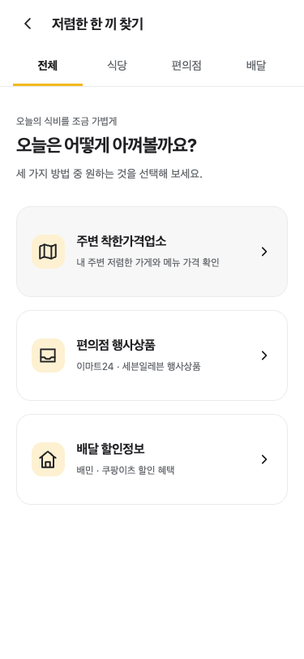
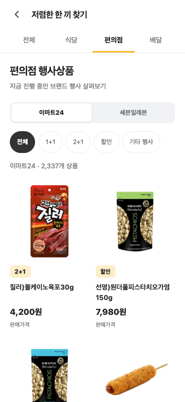
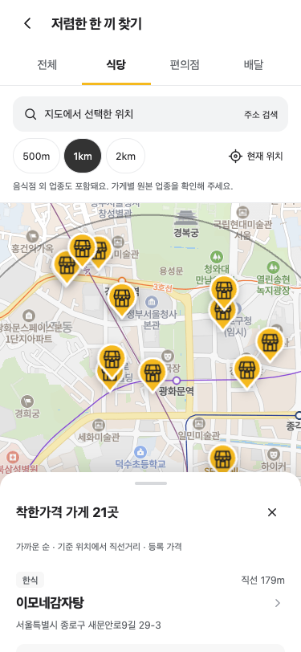
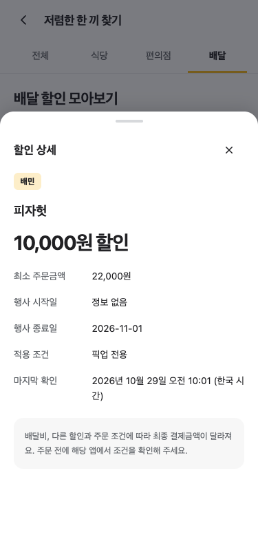

# 저렴한 한 끼 통합 검증

검증일: 2026-10-29, Asia/Seoul. 공식 팀 저장소의 `feat/461-cheapmeal` 브랜치에서 검증했다. 개인 Preview의 과거 검증 결과와 구분하며, dev/prod 배포와 PR 병합은 수행하지 않았다.

## 기준과 실행 환경

- 시작 HEAD와 fetch한 `origin/develop`: `e15644e2b204d2214f03ea8c82d57ce2bc10ecab`
- 시작 상태: 미커밋 변경 없음. 기존 작업 브랜치가 develop과 동일해 재사용했으며 다른 브랜치·worktree와 개인 저장소는 변경하지 않았다.
- Node 22.23.1, 루트·프론트엔드 lockfile 기반 `npm ci`, 새 의존성 없음
- 공식 frontend의 기존 Webpack 개발 서버: `http://localhost:3001`, `ENABLE_MSW=false`, 네이버 지도, 기존 dev API 프록시
- 자동화용 별도 Chrome 브라우저 세션. 로컬 실행에 한해 분석 환경변수는 비웠으며 공통 PostHog 코드는 변경하지 않았다.

## 실제 dev API

14:18 KST에 [실행 리비전](https://dev-api.jachwi-sunbae.kr/actuator/info)과 [OpenAPI](https://dev-api.jachwi-sunbae.kr/v3/api-docs)를 확인했다. 배포 버전은 2.1.0, 커밋은 `e15644e2b204d2214f03ea8c82d57ce2bc10ecab`이다. 별도 익명 검증 회원으로 로그인·refresh했으며 동일 회원 복원과 Secure/HttpOnly 쿠키를 확인했다. 토큰·쿠키·회원 ID는 기록하지 않았다. 로그인에 생성된 검증 회원은 삭제 API가 없어 남는다. 업소·상품·할인 데이터는 조회만 했다.

| 조회                      | 인증 응답 | 인증 없는 응답 | 데이터                                           |
| ------------------------- | --------- | -------------- | ------------------------------------------------ |
| 서울시청 1km 착한가격업소 | 200       | 401            | 22곳, 기타비요식업 1곳 포함, 기준일 2026-06-30   |
| 이마트24 행사상품         | 200       | 401            | 2,337개, 수집 2026-10-29 04:02 KST               |
| 세븐일레븐 행사상품       | 200       | 401            | 2,324개, 전부 UNKNOWN, 수집 2026-10-29 13:25 KST |
| 배달 할인정보             | 200       | 401            | 108개, 배민 71 / 쿠팡이츠 37                     |

이마트24는 1+1 690개, 2+1 777개, 할인 489개, 3+1 7개, 골라담기 374개다. 세븐일레븐은 1+1 918개, 2+1 926개, 할인 480개다. 개인 구현의 오전 기록과 달리 세븐일레븐은 실제 수집이 완료돼 있었으며, 수집을 실행하거나 데이터를 채우지 않았다. 수집 시각·개수는 검증 시점의 값이다.

## 자동 검사

| 명령                             | 결과                                  |
| -------------------------------- | ------------------------------------- |
| `npm run lint`                   | 통과                                  |
| `npm run format:check`           | 통과                                  |
| `npm run typecheck`              | 통과                                  |
| `npm test`                       | 100개 파일, 701개 테스트 통과         |
| `npm run build`                  | 타입 검사와 production 번들 생성 통과 |
| 루트 `npm run format:docs`       | 실행 후 diff 확인                     |
| 루트 `npm run format:docs:check` | 통과                                  |

기존 지도·인증·매물·체크리스트·홈 테스트를 포함한다. 새 페이지 27개 테스트는 홈 카드, 초기 API 지연 조회, 탭·브랜드·행사·플랫폼 상태 유지, 24개씩 추가 표시, 3+1/골라담기, 세븐일레븐 UNKNOWN, 이미지 오류, 상세·Escape·뒤로가기·초점 복원, nullable 조건, 주소 검색·고정 2km 반경·마커, 명시적 위치 요청·거부·재시도, 미수집·수집 완료 0건·필터 0건·API 오류·401 갱신·403을 검증한다. 파서 테스트는 금액·가격 원문과 enum·null·빈 응답을 확인한다.

추가 테스트를 작성하면서 접근성 이름의 공백과 테스트 회원 ID 설정을 수정했다. 타입 검사에서 Testing Library가 지원하지 않는 `exact` 옵션을 제거한 뒤 다시 검사했다. 실패를 무시하거나 검사를 생략하지 않았다.

## 통합 후 브라우저 확인

Playwright로 실제 Chrome과 공식 frontend 개발 서버를 실행했다. 아래 정상 흐름은 MSW·샘플 데이터 없이 실제 dev API를 사용했다. 이 최초 통합 기록과 캡처는 반경 선택 버튼을 제거하기 전 기준이다.

- 375×812: 홈 카드 → 전체 → 편의점 → 상품 상세 → 뒤로가기 → 세븐일레븐 → 배달 → 할인 상세
- 320×568 / 375×812 / 1280×900: 전체·식당·편의점·배달에서 가로 넘침 없음. 데스크톱 홈의 기존 진입 링크 유지
- 편의점 24 → 48개 표시, 탭 왕복 시 목록 스크롤·표시 개수 유지. 이마트24 기타 행사 381개, 세븐일레븐 기타 행사 0건, 1+1 918개와 UNKNOWN 상세
- 쿠팡이츠 37개 필터, 편의점·배달 왕복 시 필터 유지
- 실제 네이버 지도 타일·마커, 서울시청 주소 검색, 500m/1km/2km, 마커 상세, 뒤로가기, 지도 드래그 후 재검색
- 상품 시트의 배경 스크롤 잠금·복원, Tab 초점 제한, Escape 닫기. 작은 화면에서 상품·배달·업소 시트 내부 스크롤과 업소 시트 키보드 확장
- 카테고리 직접 URL 진입 및 새로고침 후 인증 복원·실제 목록 표시
- 정상 흐름과 오류 복구 흐름에서 처리되지 않은 JavaScript 오류 0건

로딩·오류 확인은 **브라우저 요청을 일시 지연하고 네트워크 실패를 주입하는 별도 검사**로 수행했다. 재시도 전 주입을 제거하고 실제 API의 24개 상품 표시가 복구되는 것을 확인했다. 미수집·서버 500·401/403·위치 권한 거부·이미지 실패는 컴포넌트 테스트 fixture로 재현했다. 실제 서버에 장애를 일으키거나 수집 상태를 바꾸지 않았다.

### 실제 브라우저 캡처

모두 이번 공식 frontend 통합 결과의 브라우저 캡처이며 iPhone 실기기 사진이 아니다. 상품·업소·할인은 당시 API 응답이다.

| 전체 375px                                      | 편의점 375px                                      |
| ----------------------------------------------- | ------------------------------------------------- |
|  |  |

| 지도 재검색 375px                          | 할인 상세 375px                                             |
| ------------------------------------------ | ----------------------------------------------------------- |
|  |  |

[상품 상세](images/cheap-meals/product-detail-mobile.png), [데스크톱 홈](images/cheap-meals/home-desktop.png)도 함께 기록했다.

## PR 재검토 회귀 검사

최초 PR 커밋의 694개 테스트에 다음 7개 회귀 사례를 보강했다.

- 같은 업소 마커를 여러 번 선택한 뒤 닫기 한 번으로 목록 복원
- 업소 상세 → 주소 검색 → 새 동네 선택 후 뒤로가기 시 이전 탭 복귀
- 주소 검색 닫기·브라우저 뒤로가기 각각에 대해 진행 중인 위치 요청의 늦은 응답 무시
- 업소 상세·주소 검색 URL 직접 진입 각각에 대해 현재 카테고리를 유지하며 닫기
- 공통 지도 좌표 메뉴가 열린 상태에서 SDK 인증 실패 시 폐기된 오버레이에 접근하지 않고 오류 화면 표시

상세 이력은 `useRestaurantOverlay`로 분리해 마커 재선택·검색 전환 시 하나의 이력을 교체한다. 위치 요청은 검색 종료·탭 이탈 때 무효화한다. 공통 지도는 좌표 메뉴 정리에도 SDK 유효성 검사를 적용한다. 기능 타입·표시 상수는 `model`로 옮기고 컴포넌트 Props와 Boolean 이름, 지도 Hook의 목록 열기·닫기 인터페이스를 팀 컨벤션에 맞췄다.

수정 후 실제 dev API를 연결한 Chrome 375px에서 마커 중복 선택과 한 번 닫기, 업소 상세에서 주소 검색 후 뒤로가기, 상세 URL 직접 진입·닫기, 상품·배달 상세를 다시 확인했다. 처리되지 않은 JavaScript 오류는 없었다. GPS 지연과 SDK 객체 폐기는 회귀 테스트로 검증했다. 이 재검토의 검사 결과는 로컬 변경 기준이며 기존 PR의 CI 결과와 구분한다.

## dev Merge 이후 수동 QA

이번에는 iPhone 실기기와 App Store 배포 앱을 직접 실행하지 않았다. 개인 저장소의 WebView 코드는 참고로 읽었지만 그것이 현재 배포 바이너리와 같다고 가정하지 않았다. 새 화면은 `100dvh`, Safe Area 여백, 일반 HTTPS·tel 링크, Router history와 기존 인증 쿠키 구조를 사용한다.

- [ ] develop PR 병합 후 팀 자동 배포가 끝나면 dev 웹의 홈 카드와 네 카테고리를 다시 확인한다.
- [ ] 실제 모바일 셸이 dev 웹을 열 수 있는 기존 QA 환경에서 상·하단 Safe Area, 네이티브 탭바 겹침, 키보드, 작은 화면·큰 글꼴·가로 모드를 확인한다.
- [ ] 상품·배달·업소 상세를 연 상태에서 네이티브 뒤로가기·스와이프, 닫기, 새로고침을 확인한다.
- [ ] 현재 위치 권한 허용·거부·재허용과 주소 검색 대체 흐름을 실기기에서 확인한다.
- [ ] 공식 출처·외부 지도 링크와 전화 링크가 셸의 외부 열기 정책에 맞게 동작하는지 확인한다. 이번 검증에서 전화 발신은 하지 않았다.
- [ ] iOS WKWebView·Android WebView의 인증 쿠키와 재방문 복원을 확인한다.
- [ ] dev 웹에서 `?ut_session_id=UT00-P00`을 연 뒤 진입, 카테고리 선택, 상세, 외부 이동을 한 번씩 하고 PostHog에 이벤트 4개가 `ut_session_id`와 함께 들어오는지 확인한다. 끝나면 `?ut_session_id=0`으로 지운다.
- [ ] 데스크탑(1024px 이상)에서 상품 4열, 배달 2열, 식당 목록과 상세와 지도 세 칸, 가운데 상세 창을 확인한다.

App Store 앱은 운영 웹을 사용하므로 dev 병합만으로 운영 앱에 새 기능이 생기지는 않는다. 운영 웹 배포와 앱 업데이트는 이번 범위에 없으며, 네이티브 수정이 필요한지 여부는 위 수동 QA 이후 별도 판단한다.

남은 제약: 서버 페이지네이션이 없어 전체 응답을 내려받는다. 네이버 SDK 인증 실패 재시도는 전체 새로고침이며 필터가 초기화된다. 세븐일레븐의 미수집 상태와 아직 없는 nullable 데이터 조합은 실제 데이터 대신 테스트 fixture로 검증했다.
